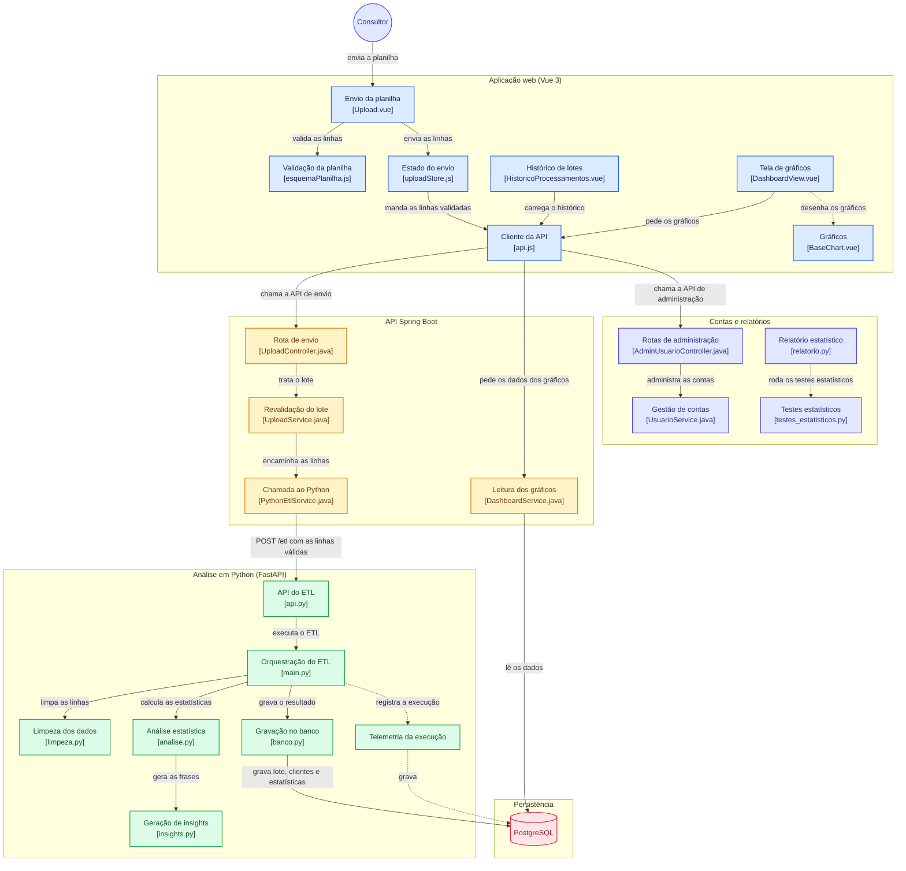

# Sistema CTI Insights

Projeto Integrador II (Tecnologia em Análise e Desenvolvimento de Sistemas, SENAI "Roberto Mange"). A empresa parceira é a **Provedor CTI** (Cti Comunicação de Dados e Tecnologia LTDA).

> **Pergunta-guia:** como transformar a planilha Excel da CTI em um sistema web que trata os dados automaticamente e mostra insights estratégicos para a empresa?

A CTI mantém sua carteira de clientes em planilhas preenchidas à mão, e por isso:
- a mesma informação aparece escrita de formas diferentes ("IND.", "Industria", "INDUSTRIA");
- há campos em branco;
- não existe nenhuma análise sobre segmentos, níveis A/B/C ou serviços.

O CTI Insights recebe a planilha, padroniza e valida os dados, grava tudo num banco PostgreSQL, calcula estatísticas e mostra os resultados em dashboards.

## Como as partes se conectam

```
Planilha ─▶ Pinia valida ─▶ Spring valida ─▶ POST /etl ─▶ Python (FastAPI + pandas)
                                                              │ cria o lote, limpa, calcula, grava
   Gráficos (Chart.js) ◀── GET /api/dashboard ◀── Spring lê ◀── PostgreSQL ◀─┘
```

### Arquitetura



É um ETL: **E**xtrair, o Spring entrega ao Python só as linhas válidas, em JSON; **T**ransformar, o Python limpa, padroniza, calcula e escreve as frases; **C**arregar, o Python grava no banco. O Java valida e encaminha; quem grava a planilha no banco é só o Python.

1. O consultor faz login no front e carrega a planilha. O Pinia valida no navegador e o Spring valida de novo (`ClienteDTO` + `ClienteValidacaoService`).
2. No envio, o `PythonEtlService` faz `POST /etl` na API do Python com `{arquivoNome, recebidas, invalidas, comAviso, linhas}` (o modelo `Pedido` do `api.py`) e espera a resposta `{"ok": true, "loteId": ...}`.
3. O Python (`analytics-python/`) cria o lote (`upload_lote`, status `PROCESSANDO`), limpa (`limpeza.py`), calcula média, mediana, desvio e agrupamentos (`analise.py`), escreve os insights (`insights.py`) e grava consultores, segmentos e serviços sem repetir, os clientes, os contratos e o JSON dos gráficos em `estatistica_lote` (`banco.py`). O lote vira `PROCESSADO`, ou `ERRO` com a mensagem.
4. A tela **Gráficos** lê esse JSON por `GET /api/dashboard` e desenha com Chart.js; a caixa "Planilha (lote)" troca de lote (`GET /api/dashboard/lotes`).

## Estrutura do repositório

| Pasta | Conteúdo | Disciplina |
| --- | --- | --- |
| [`frontend/`](frontend/) | Vue 3, Vite, Tailwind, Pinia, Vue Router e Axios | Frameworks Front-end |
| [`backend/`](backend/) | Java 21 e Spring Boot 4 (Web MVC, Data JPA, Security com JWT, Validation) | Desenvolvimento Back-end |
| [`analytics-python/`](analytics-python/) | Python com FastAPI, pandas, SciPy, SQLAlchemy e Matplotlib: o ETL que limpa, calcula, gera os insights e grava no banco, e o relatório com os testes estatísticos e os 4 gráficos (`output/`) | Ciência de Dados |
| [`database/`](database/) | `schema.sql`: a estrutura do banco no PostgreSQL. `migracao-01-nomes-das-tabelas.sql` e `migracao-02-python-grava-o-lote.sql`: atualizam um banco criado por uma versão anterior do projeto | Back-end / Nuvem |
| [`sample-data/`](sample-data/) | `dados.xlsx`: a planilha modelo, para testar o upload depois do deploy | Todas |

O código do back-end fica em `backend/src/main/java/br/com/cti/insights/` e segue as camadas do Spring:

| Pacote | Papel |
| --- | --- |
| `controller` | Porta HTTP. Recebe o JSON ou o arquivo e devolve a resposta com o status certo. Aqui também fica o `ErroHandler`, que transforma cada erro numa resposta JSON clara. |
| `service` | Regras de negócio: e-mail único, login, revalidação do envio (`UploadService`), chamada ao Python (`PythonEtlService`) e leitura do dashboard. O Java só grava a tabela `usuario`: a `Telemetria` de cada envio e de cada execução quem grava é o Python (`banco.registrar_telemetria`). |
| `repository` | Acesso ao banco com Spring Data JPA. |
| `model` | Entidades: `Cliente`, `Consultor`, `Segmento`, `Contrato`, `Servico`, `UploadLote`, `EstatisticaLote`, `Insight` (com subclasses), `Telemetria` e `Usuario`. |
| `dto` | O que entra e sai da API, com as validações declarativas (`@NotBlank`, `@Positive`, `@Pattern`...). `ClienteDTO` é uma linha da planilha; os `...RespostaDTO` são o que a API devolve. A senha nunca sai. |
| `exception` | Exceções próprias tratadas pelo `ErroHandler`, entre elas as três do plano: `ExcelInvalidoException` (formato não aceito ou planilha sem linhas), `ColunaObrigatoriaException` (falta uma coluna, ex. "segmento") e `ClienteDuplicadoException` (código CTI repetido). |
| `config` | Segurança, CORS e `AppProperties` (endereço e chave da API do Python). |

## Como rodar na sua máquina

**Pré-requisitos:**
- JDK 21 ou mais novo (o 25 também serve);
- Node.js 22 ou mais novo;
- Python 3.11 ou mais novo;
- um PostgreSQL.

O banco pode ser local (instalado ou pelo Docker) ou na nuvem.

**1. API do Python** (`http://localhost:8000`), ligada **antes** de enviar a planilha:

```bash
cd analytics-python
python -m venv .venv
.venv\Scripts\Activate.ps1                 # Linux/Mac: source .venv/bin/activate
pip install -r requirements.txt
copy .env.example .env                     # Linux/Mac: cp; preencha com os dados do banco
python testar_conexao.py                   # deve mostrar "Conectou!"
uvicorn api:app --port 8000                # confira http://localhost:8000/saude
```

Relatório em arquivos, sem banco: `python relatorio.py` lê `amostras/lote_exemplo.json` e gera em `output/` o `indicadores.json` (com os testes de Shapiro-Wilk e qui-quadrado), o `insights.json` e os 4 gráficos (linha, dispersão, histograma e boxplot).

Sem o Python no ar, nada é gravado: a tela avisa que o processamento está indisponível e o motivo técnico ("Não foi possível falar com o serviço Python") fica no log do backend. Para testar só o Python, sem banco: `http://localhost:8000/docs` > `POST /testar` com o conteúdo de `amostras/clientes.json`. Para ver os lotes gravados sem abrir o DBeaver: `GET /lotes`.

**Banco com as tabelas antigas (`clientes`, `contratos`...):** rode [`database/migracao-01-nomes-das-tabelas.sql`](database/migracao-01-nomes-das-tabelas.sql) uma vez (no DBeaver) **antes** de subir o back-end novo. Ele renomeia `clientes`, `contratos`, `consultores` e `servicos` para os nomes que o `banco.py` usa, sem perder dados.

**Banco com a tabela `usuarios` e a `upload_linha`:** rode [`database/migracao-02-python-grava-o-lote.sql`](database/migracao-02-python-grava-o-lote.sql) uma vez, com o back-end desligado. Ele renomeia `usuarios` para `usuario`, cria a tabela `segmento` (e liga os clientes a ela), tira `enviado_por` do lote, cria `linhas_com_aviso` e apaga a `upload_linha`, que o Java não usa mais. Um banco novo já nasce certo.

**2. Back-end** (`http://localhost:8080`):

```bash
cd backend
./mvnw spring-boot:run
```

Para usar o banco da Azure, copie `backend/src/main/resources/application-local.properties.exemplo` para `application-local.properties` (o arquivo fica fora do Git), preencha com os dados do servidor e rode com o perfil `local`:

```bash
./mvnw spring-boot:run -Dspring-boot.run.profiles=local                 # Linux/macOS/Git Bash
.\mvnw.cmd spring-boot:run "-Dspring-boot.run.profiles=local"           # Windows (PowerShell)
```

Sem perfil nem variáveis de ambiente, ele procura um PostgreSQL em `localhost:5432`, banco `cti`, usuário e senha `postgres`. As tabelas são criadas sozinhas na primeira execução. Para subir um banco assim com Docker:

```bash
docker run -d --name cti-postgres -e POSTGRES_PASSWORD=postgres -e POSTGRES_DB=cti -p 5432:5432 postgres:17
```

**3. Front-end** (`http://localhost:5173`):

```bash
cd frontend
npm install
npm run dev
```

Abra `/cadastro`, crie a conta de consultor e envie a planilha de exemplo [`frontend/planilhas-exemplo/dados.xlsx`](frontend/planilhas-exemplo/).

### Variáveis de ambiente

| Variável | Onde | Para quê | Padrão |
| --- | --- | --- | --- |
| `DB_URL` | Back-end | Endereço JDBC completo, como no Azure: `jdbc:postgresql://SERVIDOR.postgres.database.azure.com:5432/ctiinsights?sslmode=require`. Quando definido, vale no lugar de `DB_HOST`/`DB_PORT`/`DB_NAME`/`DB_SSLMODE` | vazio |
| `DB_HOST`, `DB_PORT`, `DB_NAME`, `DB_USER`, `DB_PASSWORD` | Back-end | Conexão com o PostgreSQL (`DB_USER` e `DB_PASSWORD` valem também com `DB_URL`) | `localhost`, `5432`, `cti`, `postgres`, `postgres` |
| `DB_SSLMODE` | Back-end | Use `require` no Azure e em qualquer banco na nuvem | `prefer` |
| `JWT_SECRET` | Back-end | Chave que assina o token de login. **Obrigatória em produção**, com 32 caracteres ou mais. (`JWT_SEGREDO` também é aceito.) | Aleatória a cada inicialização |
| `JWT_VALIDADE` | Back-end | Por quanto tempo o login vale | `2h` |
| `LOGIN_TENTATIVAS`, `LOGIN_BLOQUEIO` | Back-end | Senhas erradas seguidas para o mesmo e-mail antes de bloquear o login, e por quanto tempo | `5`, `15m` |
| `CORS_ORIGINS` | Back-end | Endereços do front que podem chamar a API, separados por vírgula (no deploy, o endereço da Vercel). (`CORS_ORIGIN` e `CORS_ORIGENS` também são aceitos.) | `http://localhost:5173` |
| `ETL_URL` | Back-end | Endereço da API do Python | `http://localhost:8000/etl` |
| `ETL_KEY` | Back-end | Chave enviada no cabeçalho `X-ETL-Key`; igual ao `ETL_API_KEY` do Python | vazia (sem chave) |
| `ADMIN_EMAIL`, `ADMIN_PASSWORD` | Back-end | Primeiro administrador, garantido ao subir (a senha só é usada se a conta não existir) | vazios (nenhum) |
| `DB_HOST`, `DB_PORT`, `DB_NAME`, `DB_USER`, `DB_PASSWORD`, `DB_SSLMODE` | Python (`analytics-python/.env`) | O mesmo banco do back-end | `localhost`, `5432`, `ctiinsights`, `cti`, `cti123`, `prefer` |
| `ETL_API_KEY` | Python (`.env`) | Chave exigida no `POST /etl` (errada = 401) | vazia (sem chave) |
| `VITE_API_URL` | Front-end | Endereço da API. Com ou sem `/api` no final: o front acrescenta quando falta. | `http://localhost:8080` |

## API

Todas as rotas, menos `/api/health`, o cadastro e o login, exigem o header `Authorization: Bearer <token>`.

**Tentativas de login.** Depois de 5 senhas erradas seguidas para o mesmo e-mail, o login desse e-mail fica bloqueado por 15 minutos (resposta 429), mesmo com a senha certa. Acertar a senha antes disso zera a contagem.

**Aprovação de contas.** O cadastro é público, mas a conta nasce **pendente** e só entra depois que um administrador aprova na tela **Usuários** (menu visível só para `ADMIN`). Cada conta tem:
- um **perfil**, `USER` ou `ADMIN`, que vai dentro do token;
- um **status**, `PENDENTE`, `APROVADO` ou `BLOQUEADO`.

Bloquear tira o acesso na hora: a cada pedido o servidor confere se a conta continua aprovada, mesmo com o token ainda válido.

**Primeiro administrador:** defina `ADMIN_EMAIL` (e `ADMIN_PASSWORD`, se a conta ainda não existir) e suba o back-end. A conta vira `ADMIN` e aprovada. Depois disso, os próprios administradores promovem outras pessoas na tela Usuários; o perfil novo vale a partir do próximo login. As contas que já existiam antes da aprovação continuam entrando (status `APROVADO`).

| Verbo | Rota | O que faz |
| --- | --- | --- |
| GET | `/api/health` | Confere se a API está no ar (teste do deploy). Devolve `{ "status": "ok" }`, sem token |
| POST | `/api/auth/register` | Cadastro do consultor: nome (o mesmo da coluna consultor da planilha), e-mail, senha (8 a 72 caracteres, com letras e números) e matrícula opcional. `consultor` só é preciso se for diferente do nome. O e-mail é gravado em minúsculas. |
| POST | `/api/auth/login` | Login. Devolve `{ token, expiraEm, usuario }` |
| GET | `/api/auth/me` | Quem está logado, lido do próprio token |
| GET, POST, PUT, DELETE | `/api/usuarios`, `/api/usuarios/{id}` | Consultar, cadastrar, alterar e remover usuários (**só ADMIN**) |
| GET | `/api/admin/usuarios?status=` | Contas para aprovação, filtradas por `PENDENTE`, `APROVADO` ou `BLOQUEADO` (**só ADMIN**) |
| PATCH | `/api/admin/usuarios/{id}/status`, `/api/admin/usuarios/{id}/perfil` | Aprovar, bloquear ou reativar; tornar ou deixar de ser `ADMIN` (**só ADMIN**; ninguém altera a própria conta) |
| POST | `/api/clientes/validar` | Recebe em JSON as linhas que o Pinia aprovou, valida de novo (DTO + `ClienteValidacaoService`: código repetido e padronização) e devolve a lista padronizada. Não grava e não chama Python. |
| POST | `/api/uploads/validadas?arquivo=&recebidas=&comAviso=` | Recebe as linhas que o Pinia aprovou (lista de `ClienteDTO`), valida de novo e chama o Python, que cria o lote e grava tudo. Responde 201 com o lote já processado; 503 se o Python não respondeu e 502 se ele falhou. |
| GET | `/api/uploads` | Lotes enviados, do mais recente para o mais antigo, com status e mensagem |
| GET | `/api/dashboard?loteId=` | `{ lote, geradoEm, estatisticas }`: o JSON que o Python gravou em `estatistica_lote`. Sem `loteId`, o último lote processado. `estatisticas` vem nulo enquanto o Python não terminou. |
| GET | `/api/dashboard/lotes` | Os 20 últimos lotes, para a caixa "Planilha (lote)" da tela Gráficos |
| GET, POST, PUT, DELETE | `/api/clientes`, `/api/clientes/{id}` | CRUD de clientes |
| PATCH | `/api/clientes/{id}/nivel` | Altera só o nível A/B/C |
| GET, POST | `/api/clientes/{id}/contratos` | Contratos do cliente |
| PATCH | `/api/contratos/{id}/cancelamento` | Cancela o contrato, que continua no histórico |
| DELETE | `/api/contratos/{id}` | Remove o contrato |

Os erros vêm no formato `{ "mensagem": "..." }`. Na validação vêm também `campo` e `erro` (o primeiro problema), `posicao` (o item da lista, quando o corpo é uma lista) e `campos` (todos). Uma regra do Service vem como `{ "mensagem": "Regra de validação não atendida", "erro": "Código repetido na planilha: CTI001" }`:

| Status | Quando acontece |
| --- | --- |
| 400 | Dados inválidos ou formato de arquivo não aceito |
| 401 | Sem login, token vencido ou conta bloqueada durante a sessão |
| 403 | Conta pendente ou bloqueada no login, ou rota só de `ADMIN` |
| 404 | O registro não existe |
| 409 | E-mail, código CTI ou matrícula repetidos |
| 422 | Falta uma coluna obrigatória na planilha |
| 502 | O processamento da planilha falhou (o lote fica com `ERRO`) |
| 503 | O processamento está fora do ar: nada foi gravado, dá para enviar de novo |
| 429 | Senhas erradas demais seguidas no login: espere o bloqueio vencer |

## Deploy

Back-end no **Azure App Service** (Java 21), banco no **Azure Database for PostgreSQL** e front-end na **Vercel**.

1. **Back-end (Azure):** publique a pasta `backend/` e configure no App Service `DB_URL` (com `sslmode=require`), `DB_USER`, `DB_PASSWORD`, `JWT_SECRET` e `CORS_ORIGINS` com o endereço da Vercel. Se usar o Python, defina também `ETL_URL` e `ETL_KEY`.
2. **Teste:** abra `https://SEU-BACKEND.azurewebsites.net/api/health`; a resposta precisa ser `{"status":"ok"}`.
3. **Front-end (Vercel):** importe o repositório com **Root Directory** `frontend` e defina `VITE_API_URL` com o endereço do back-end. O `frontend/vercel.json` já manda todas as rotas para o `index.html`, então recarregar `/dashboard` não dá 404.

Senhas e chaves ficam só nas configurações do Azure e da Vercel, nunca no Git.

## Testes

```bash
cd backend && ./mvnw test                                  # API, regras, envio do lote ao Python e schema.sql
```

Os testes do back-end usam o H2 em memória, então não precisam de PostgreSQL nem do Python: o teste do `PythonEtlService` sobe um servidor HTTP falso no lugar da API do Python, que cria o lote como o `banco.py`, e confere o JSON e a chave enviados.

Para testar o Python: `POST /testar` com `amostras/clientes.json` deve dar 2 clientes e média 1.135.000. Com a planilha modelo (`sample-data/dados.xlsx`), o lote deve terminar `PROCESSADO` com 32 clientes, 61 contratos, 6 segmentos, 4 consultores, 6 serviços, faturamento total de R$ 72.360.000,00 e média 2.261.250 (confira no DBeaver com `SELECT COUNT(*)` em `cliente` e `contrato`).

Mudou uma entidade? Regere o [`database/schema.sql`](database/schema.sql) com:

```bash
cd backend && ./mvnw test -Dtest=SchemaSqlTests -DatualizarSchema=true
```

## Dados e privacidade

A planilha deste repositório é **fictícia**, feita para testes. Os dados reais da CTI são confidenciais e usados só para fins acadêmicos: não devem ser commitados nem publicados.

No sistema:
- as senhas ficam guardadas só como hash;
- o acesso exige login;
- a API só aceita chamadas dos endereços do front configurados.

## Mais detalhes

- [`frontend/README.md`](frontend/README.md): telas, regras de padronização da planilha e onde mexer.
